```{r}
#| include: false
#| echo: false
#| label: "setup"
library(ggstatsplot)
library(ggplot2)
library(magrittr)
set.seed(123)
```

## Statistical Visualizations with {ggstatsplot}: A Biography {style="margin-top: 1em;"}

:::: {.columns}

::: {.column width='40%'}

::: {style="margin-top: 0.5em; margin-bottom: 0.5em; font-size: 1em"}
Indrajeet Patil<br>
:::

:::

::: {.column width='60%'}
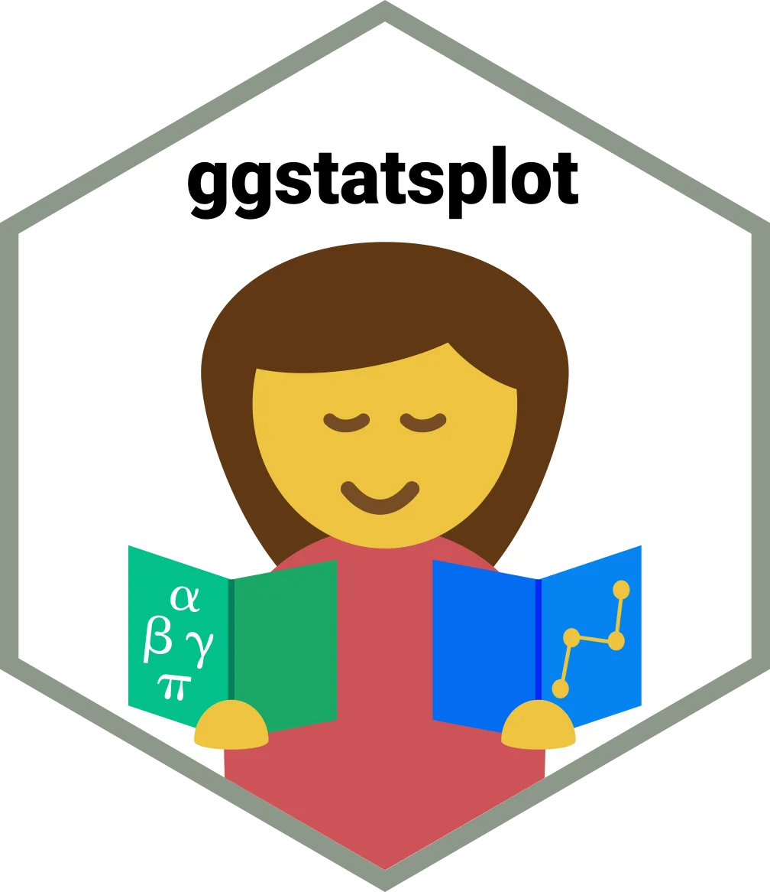{.relative fig-align="center" width="350" height="350" fig-alt="ggstatsplot hexagonal logo: a person reading a book of statistics and plots."}
:::

::::

::: {.footer style="text-align: center; font-size: 0.55em; color: #666; position: absolute; bottom: 20px; left: 0; right: 0;"}
Source code: [github.com/IndrajeetPatil/intro-to-ggstatsplot](https://github.com/IndrajeetPatil/intro-to-ggstatsplot){style="text-decoration: underline;"}
:::

::: {.notes}
- Welcome attendees and introduce the talk on `{ggstatsplot}`.
- Introduce myself and explain the perspective of the talk: an autobiographical retrospective charting the growth of an open-source statistical software package.
- Direct attendees to the presentation repository on GitHub shown in the footer.
:::

# Genesis

Why a new software?

::: {.notes}
- Open the Genesis section to explore the motivation for creating `{ggstatsplot}`.
- Pose the framing question: why write and maintain a new R package when the R ecosystem already possesses powerful visualisation tools like `{ggplot2}`?
:::

## Life in the trenches (c. 2017, Harvard) {.smaller}

:::: {.columns}

::: {.column width='50%'}

:::{.callout-caution collapse=false appearance='default' icon=true}

## External Stimulus

- **Reporting errors**: 

> "half of all published psychology papers contained at least one *p*-value that was inconsistent"^[[(Nuijten et al., *Behavior Research Methods*, 2016)](https://link.springer.com/article/10.3758/s13428-015-0664-2)]

- **Interpretation errors**: 

> "in 72% of cases, nonsignificant results were misinterpreted [to mean] that effect was absent"^[[(Aczel et al., *AMPPS*, 2018)](https://journals.sagepub.com/doi/pdf/10.1177/2515245918773742)]

- **Replication crisis**: 

> "39% of effects were subjectively rated to have replicated the original result"^[[Open Science Collaboration, *Science*, 2015](https://www.science.org/doi/10.1126/science.aac4716)]

and more...

:::

:::

::: {.column width='50%'}

:::{.callout-warning collapse=false appearance='default' icon=true}

## Internal Response

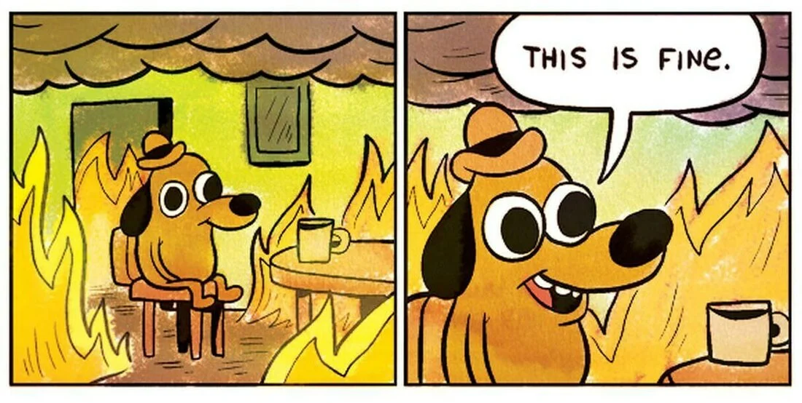{.relative fig-align="center" fig-alt="A dog sits in a burning room saying, This is fine, illustrating complacency amid research problems."}
How to: 

- avoid reporting errors?
- improve quality of statistical reporting?
- emphasize the importance of the effect?
- interpret null results?
- easily assess validity of model assumptions?
- increase replicability?

:::

:::

::::

::: {.notes}
- Recount the academic research context circa 2017 at Harvard that precipitated the project.
- Walk through the external stimulus on the left: widespread statistical reporting errors (Nuijten et al., 2016), frequent misinterpretation of nonsignificant p-values as absent effects (Aczel et al., 2018), and the broader replication crisis (Open Science Collaboration, 2015).
- Connect this to the internal response on the right (captioned with the iconic "This is fine" meme): the urgent practical need to prevent transcription errors, report effect sizes with uncertainty, properly interpret null results, and make assumption checking routine.
:::

# Proposal

Information-rich, ready-made statistical visualizations

:::{style="font-size: 20px;"}
(minimal effort and maximum transparency)
:::

::: {.notes}
- Introduce the proposed philosophy: information-rich, ready-made statistical visualisations that combine plots and analysis into one artefact.
- Stress the guiding mission: requiring minimal effort from users while delivering maximum transparency and methodological rigor.
:::

## A visualization with statistical summary {.smaller .nostretch}

{height="422" style="max-width: 100%;" fig-alt="Animated scatterplots change shape while their means, standard deviations, and correlation remain nearly identical, showing why summary statistics alone can mislead."}

:::{style="background-color: #FDE7BB; padding: 20px; border-radius: 25px; text-align: center;"}

💡 **Visualizations** reveal problems not discernible from **model summaries**!

:::

:::footer
[(Matejka & Fitzmaurice, *Autodesk Research*,2017)](https://www.autodeskresearch.com/publications/samestats)
:::

::: {.notes}
- Demonstrate the animated Datasaurus Dozen (Matejka & Fitzmaurice, 2017) to illustrate why statistical summaries alone are perilous.
- Explain that while each frame exhibits vastly different bivariate structures (including stars, circles, and a dinosaur), the means, standard deviations, and Pearson correlation coefficients remain virtually identical.
- Emphasise the takeaway in the callout: graphical inspection surfaces vital anomalies, clustering, and non-linear patterns that summary metrics completely obscure.
:::

## Ready-made plots with one-line syntax {.smaller}

::::: columns

::: {.column width="40%"}

<br>

:::{style="background-color: #FFDCA9; padding: 20px; border-radius: 25px; text-align: center;"}

The **grammar of graphics** framework can prepare **any** visualization! But building plots from scratch can be time-consuming.

:::

:::

::: {.column width="60%"}

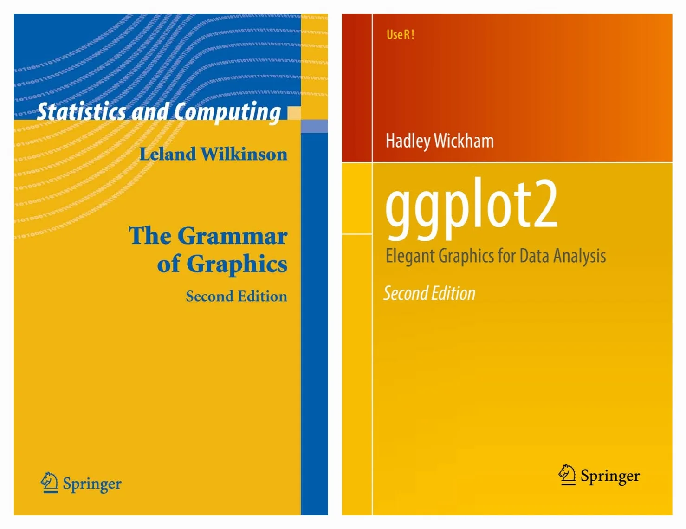{.relative fig-align="center" width="500" height="300" fig-alt="Covers of The Grammar of Graphics by Leland Wilkinson and ggplot2: Elegant Graphics for Data Analysis by Hadley Wickham."}
:::

:::::

::::: columns

::: {.column width="40%"}

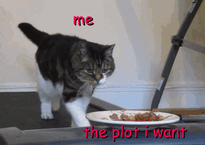{.relative fig-align="center" width="350" fig-alt="A cat on a treadmill reaches for food labeled the plot I want, illustrating the effort of building plots manually."}

:::

::: {.column width="60%"}

<br>

:::{style="background-color: #FDE7BB; padding: 20px; border-radius: 25px; text-align: center;"}

💡 Using **ready-made plots** lowers the effort needed for visualizing data!

:::

:::

:::::

::: {.notes}
- Acknowledge the unmatched flexibility of the Grammar of Graphics framework, as pioneered by Leland Wilkinson and implemented in Hadley Wickham's `{ggplot2}`.
- Discuss the practical trade-off: assembling sophisticated, publication-ready composite plots from individual geoms, themes, annotations, and statistical computations takes substantial time and code.
- Reference the treadmill cat animation to illustrate researcher exhaustion when recreating repetitive plotting pipelines.
- Highlight the core solution: ready-made plotting functions dramatically lower the activation energy required to thoroughly visualise data.
:::

# Action Plan

`{ggstatsplot}` was born!

:::{style="font-size: 20px;"}
(open-sourced on [GitHub](https://github.com/IndrajeetPatil/ggstatsplot) in 2017; still actively developed)
:::

::: {.notes}
- Announce the creation and open-sourcing of `{ggstatsplot}` on GitHub in 2017.
- Mention that the package remains actively developed, continuously incorporating community feedback and modern R standards.
:::

## Example function {.smaller}

E.g., for hypothesis about differences *between* groups

:::: {.columns}

::: {.column width='65%'}

```{.r}
ggbetweenstats(iris, Species, Sepal.Length)
```

```{r}
#| label: "ggbetweenstats_1"
#| fig-alt: "Sepal length distributions for the three iris species, with raw observations, group means, uncertainty, and statistical comparisons."
#| echo: false
#| eval: true
#| include: true
#| fig-width: 6
#| fig-height: 5
ggbetweenstats(iris, Species, Sepal.Length)
```

:::

::: {.column width='35%'}

:::{.callout-important collapse=false appearance='default' icon=true}
## 

**Information-rich defaults**

-  raw data + distributions 
-  descriptive statistics
-  inferential statistics
-  effect size + uncertainty
-  pairwise comparisons
-  Bayesian hypothesis-testing 
-  Bayesian estimation

**Statistical approaches available**

-  parametric 
-  non-parametric 
-  robust 
-  Bayesian

:::

:::

::::

::: {.notes}
- Walk through the flagship example using `ggbetweenstats(iris, Species, Sepal.Length)`.
- Point out how a single function call creates an entire multilayered composite plot: violin plots showing distribution densities, box plots indicating quartiles, jittered raw data points, mean markers, and pairwise comparisons.
- Review the information-rich defaults in the right column: automatic calculation of test statistics, effect sizes with confidence intervals, and Bayesian evidence expressions.
- Note the four interchangeable statistical approaches available: parametric, non-parametric, robust, and Bayesian.
:::

## And there is more! {.smaller .nostretch}

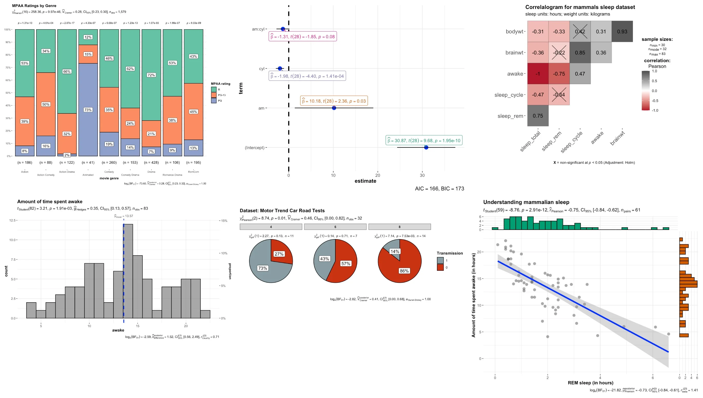{height="575" style="max-width: 100%;" fig-alt="Examples of ggstatsplot output: stacked bars, regression coefficients, correlation matrix, histogram, grouped pie charts, and a scatterplot with marginal distributions."}

:::footer
[Appendix](https://www.indrapatil.com/intro-to-ggstatsplot/#/examples-of-other-functions) provides more details.
:::

::: {.notes}
- Present the overview collage displaying the breadth of chart types provided by `{ggstatsplot}`.
- Highlight the diverse statistical templates: stacked bar charts, regression coefficients, correlation matrices, histograms, grouped pie charts, and scatterplots with marginal distributions.
- Note that the appendix contains dedicated interactive examples for each of these specialised functions.
:::

# Promised Land

Does it deliver?

::: {.notes}
- Open the Promised Land section to evaluate whether the package achieves its design goals.
- Frame the evaluation criteria: does it genuinely prevent reporting errors, simplify analysis workflows, and follow statistical best practices?
:::

## Show, don't tell {.smaller}

:::: {.columns}

::: {.column width='50%'}

**Without `{ggstatsplot}`**

:::{style="font-size: 23px; text-align: justify; text-justify: inter-word;"}

Pearson's correlation test revealed that, across 142 participants, variable `x` was negatively correlated with variable
`y`: $t(140)=-0.76, p=0.446$. The effect size $(r=-0.06, 95\% CI [-0.23,0.10])$ was small, as per Cohen’s (1988)
conventions. The Bayes Factor for the same analysis revealed that the data were `r round(exp(1.76), 2)` times more
probable under the null hypothesis as compared to the alternative hypothesis. This can be considered moderate evidence
(Jeffreys, 1961) in favor of the null hypothesis (absence of any correlation between `x` and `y`).

:::

:::

::: {.column width='50%'}

**With `{ggstatsplot}`**

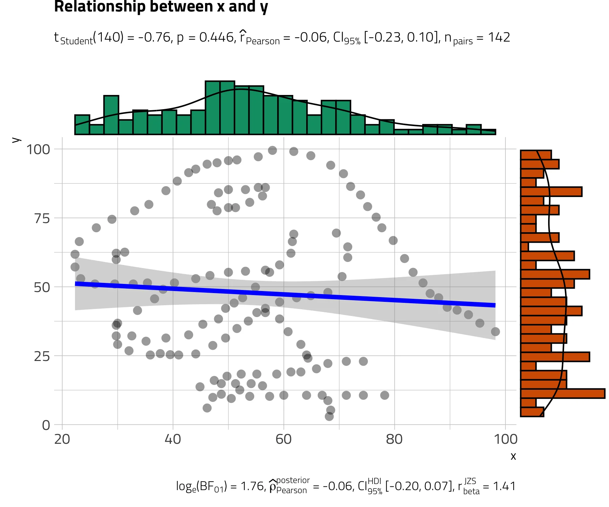{.relative fig-align="center" fig-alt="Datasaurus scatterplot with marginal histograms, a fitted line, uncertainty band, and statistical annotations; the dinosaur shape reveals structure despite a near-zero correlation."}

:::

::::

:::{style="background-color: #FDE7BB; padding: 15px; border-radius: 25px; text-align: center;"}

✅ No need to worry about reporting or interpretation errors!

:::

::: {.notes}
- Contrast the traditional reporting approach on the left with the integrated `{ggstatsplot}` visualisation on the right.
- Walk through the left column: a dense narrative paragraph of test statistics ($t(140) = -0.76, p = 0.446, r = -0.06$) that is tedious to compose and rife with opportunities for transcription errors.
- Walk through the right column: the Datasaurus scatterplot with marginal histograms and embedded subtitle annotations, which immediately reveals that the data form a dinosaur shape rather than random bivariate noise.
- Emphasise how visual presentation protects researchers from publishing misleading or erroneous claims.
:::

## Thoughtful Defaults {.smaller}

:::: {.columns}

::: {.column width='40%'}

:::{.callout-note collapse=false appearance='default' icon=true}

## Data Visualization

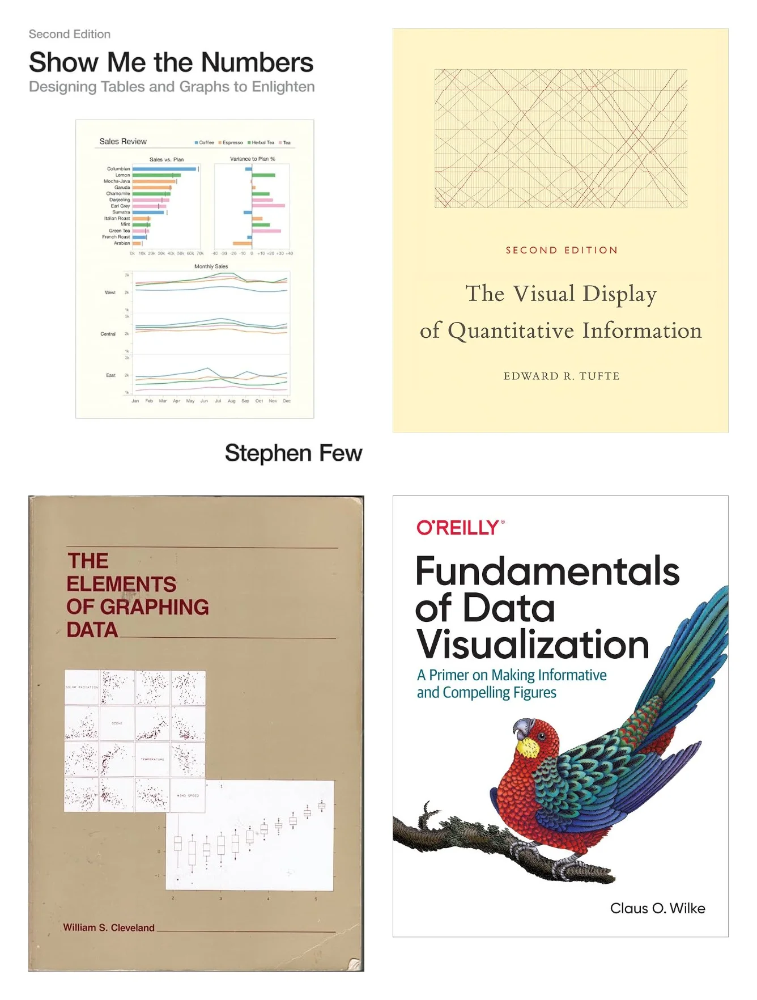{.relative fig-align="center" height="400" fig-alt="Covers of visualization references by Stephen Few, Edward Tufte, William Cleveland, and Claus Wilke that inform the plotting defaults."}

:::

:::

::: {.column width='60%'}

:::{.callout-note collapse=false appearance='default' icon=true}

## Statistical Reporting

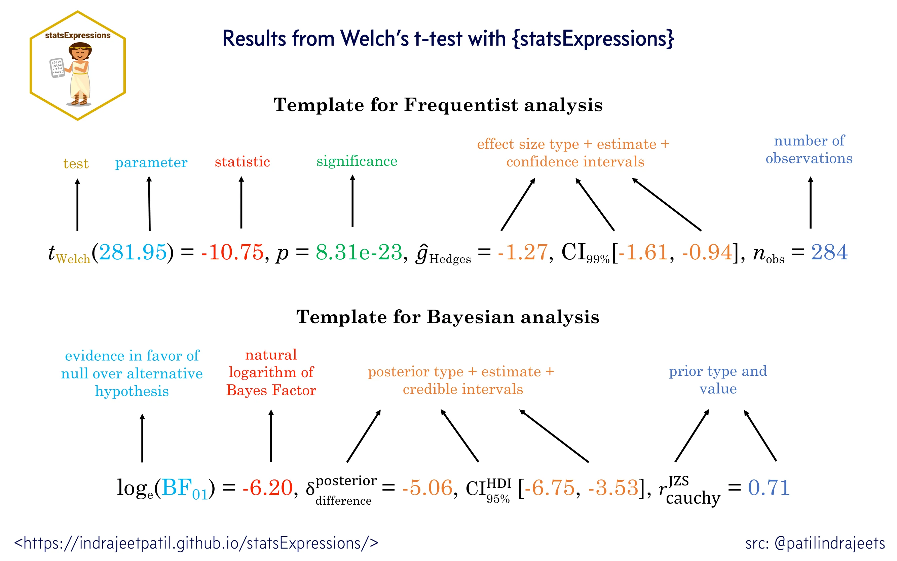{.relative fig-align="center" fig-alt="Annotated statistical reporting templates identify test statistics, significance, effect sizes, uncertainty intervals, sample sizes, Bayes factors, and priors."}

:::{style="font-size: 15px; text-align: center;"}
([Doorn et al., 2020](https://link.springer.com/article/10.3758/s13423-020-01798-5);
[APA Manual](https://apastyle.apa.org/instructional-aids/numbers-statistics-guide.pdf))
:::

:::

:::

::::

:::{style="background-color: #FDE7BB; padding: 15px; border-radius: 25px; text-align: center;"}

✅ Follows best practices in data visualization and statistical reporting!

:::

::: {.notes}
- Discuss the research foundations underlying the package defaults across two pillars.
- On data visualisation (left column): design choices rooted in seminal texts by Stephen Few, Edward Tufte, William Cleveland, and Claus Wilke to maximise data-to-ink ratio and visual honesty.
- On statistical reporting (right column): rigorous adherence to APA 7th edition guidelines and Van Doorn et al. (2020) recommendations for comprehensive Bayesian and frequentist summaries.
- Reiterate that default outputs are publication-ready without requiring manual cosmetic adjustments.
:::

# Impact

*I can haz users?!*

::: {.notes}
- Introduce the Impact section exploring the reach and reception of `{ggstatsplot}`.
- Preview the empirical usage statistics across downloads, citations, and community awards.
:::

## User Love {.smaller}

:::: {.columns}

::: {.column width='50%'}

:::{.callout-tip collapse=false appearance='default' icon=true}

## Total downloads > **800K** (97 percentile)

```{r}
#| label: "cran_downloads"
#| fig-align: center
#| echo: false
#| eval: true
#| include: false
library(packageRank)
p_downloads <- plot(
  cranDownloads("ggstatsplot", from = "2018-04-03", to = Sys.Date()),
  graphics = "ggplot2", smooth = TRUE
) 
```

```{r}
#| label: "cran_downloads_print"
#| fig-alt: "Daily CRAN downloads of ggstatsplot since April 2018, with a smoothed trend."
#| fig-align: center
#| echo: false
#| eval: true
#| include: true
p_downloads + 
  ggplot2::labs(subtitle = NULL) + 
  ggplot2::theme_minimal(base_size = 24)
```

:::{style="background-color: #FFDCA9; padding: 10px; border-radius: 25px; text-align: center; font-size:20px;"}
Second most starred `{ggplot2}`-extension!
:::

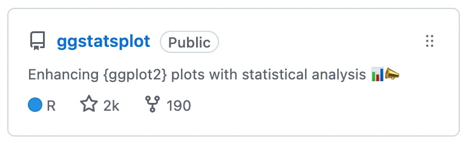{.relative fig-align="center" fig-alt="GitHub repository card for ggstatsplot showing about two thousand stars and 190 forks in the captured snapshot."}

:::

:::

::: {.column width='50%'}

:::{.callout-tip collapse=false appearance='default' icon=true}

## Total citations > **1400**

From publications across a wide range of fields: <br>
biology, medicine, psychology, economics, etc.

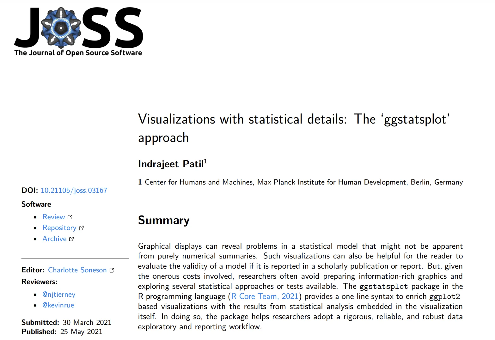{.relative fig-align="center" fig-alt="First page of the Journal of Open Source Software article Visualizations with statistical details: The ggstatsplot approach by Indrajeet Patil."}

:::{style="background-color: #FFDCA9; padding: 10px; border-radius: 25px; text-align: center; font-size:20px;"}
**[Improving Psychological Science Award](https://improvingpsych.org/mission/awards/)** (2020)
:::

<br>

:::

:::

::::

::: {.notes}
- Walk through the user adoption metrics displayed across both columns.
- Left column: over 800,000 CRAN downloads placing the package in the 97th percentile of all R packages, and ranking as the second most-starred `{ggplot2}` extension on GitHub with around 2,000 stars.
- Right column: over 1,400 academic citations spanning psychology, medicine, biology, and economics for the Journal of Open Source Software paper.
- Mention winning the 2020 Society for the Improvement of Psychological Science (SIPS) Mission Award for contributions to research transparency.
:::

# Pleasant Side Effects

*Maybe the real treasure was the skills we acquired along the way!*

::: {.notes}
- Introduce the Pleasant Side Effects section.
- Frame the personal and professional journey: how maintaining a high-impact package drove major software engineering skill acquisition and community leadership.
:::

## Software Architecture {.smaller}

Breaking down the monolith: $20K_{(2017)} \rightarrow 1K_{(2024)}$ lines of code

```{mermaid}
%%| echo: false
flowchart LR
    ggstatsplot[ggstatsplot]
    statsExpressions[statsExpressions]
    note["backend engine"]
    
    subgraph easystats[easystats]
        effectsize[effectsize]
        insight[insight]
        parameters[parameters]
        performance[performance]
        bayestestR[bayestestR]
    end
    
    %% Main dependencies
    ggstatsplot --> statsExpressions
    ggstatsplot --> dots[Other dependencies]
    
    %% Add note connecting to the main relationship
    note -.-> statsExpressions
    
    %% statsExpressions dependencies on easystats packages
    statsExpressions --> effectsize
    statsExpressions --> insight
    statsExpressions --> parameters
    statsExpressions --> performance
    statsExpressions --> bayestestR
    
    %% Styling using custom colours
    style easystats fill:#EED3B1
    
    classDef main fill:#FCF596,stroke:#333,stroke-width:3px
    classDef note fill:#ffffff,stroke:#333,stroke-width:1px,stroke-dasharray: 5 5
    
    class ggstatsplot main
    class note note
```

::: {.notes}
- Walk through the major architectural refactoring of `{ggstatsplot}`.
- Explain how a 20,000-line monolithic codebase was decomposed down to approximately 1,000 lines of glue code by extracting computational engines.
- Walk through the Mermaid diagram: `{ggstatsplot}` interfaces with `{statsExpressions}` as its computational backend, which delegates to specialised packages in the `{easystats}` ecosystem (`{effectsize}`, `{insight}`, `{parameters}`, `{performance}`, `{bayestestR}`).
- Emphasise how modular separation of concerns makes both packages significantly easier to test, benchmark, and maintain.
:::


## Collaborative Solutions {.smaller}

While re-architecting `{ggstatsplot}`, I started contributing upstream.

:::: {.columns}

::: {.column width='50%'}

:::{.callout-note collapse=false appearance='default' icon=true}

## As part of `{easystats}` core team

- leadership skills to steer the project
- long-term vision for the project
- API design
- CI infrastructure
- code review
- documentation
- scouting for new talent
- developer advocacy
- community engagement

:::

:::

::: {.column width='50%'}

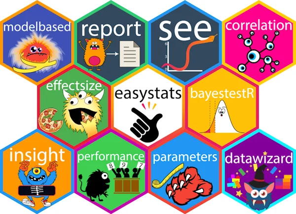{.relative fig-align="center" fig-alt="Logos of the easystats packages, including insight, parameters, performance, effectsize, bayestestR, correlation, see, report, modelbased, and datawizard."}

:::

::::

### Making it a habit

:::: {.columns}

::: {.column width='50%'}

- co-maintainer of `{ggsignif}`
- contributor to `{WRS2}`, `{ggcorrplot}`

:::

::: {.column width='50%'}

- co-author of `{lintr}` (linter for R)
- co-author of `{styler}` (code formatter)

:::

::::

::: {.notes}
- Discuss the shift towards contributing upstream to strengthen foundational dependencies.
- Highlight involvement in the `{easystats}` core team: shaping long-term architecture, API standards, CI pipelines, and mentorship.
- Point out broader ecosystem stewardship in the lower columns: co-maintaining `{ggsignif}`, contributing to `{WRS2}` and `{ggcorrplot}`, and co-authoring core developer tools `{lintr}` and `{styler}`.
- Stress that open-source sustainability relies on investing in shared upstream infrastructure.
:::

## Quality Assurance {.smaller}

> "_The only way to go fast, is to go well._"<br>
>                             \- Robert C. Martin

:::: {.columns}

::: {.column width='50%'}

:::{.callout-note collapse=false appearance='default' icon=true}

## CI Checks (GitHub Actions)

- Unit tests (random-order)
- Code coverage (100%)
- Linting (0 lints)
- Formatting (0 issues)
- Documentation (website, no link rot, plenty examples)
- Pre-commit hooks (0 issues)
- Zero user-facing warnings
- Portability (Linux, macOS, Windows)
- Robustness (dependencies, language versions)
- CRAN checks (0 notes, 0 warnings, 0 errors)

:::

:::

::: {.column width='50%'}

:::{.callout-important collapse=false appearance='default' icon=true}

## Healthy and active code base

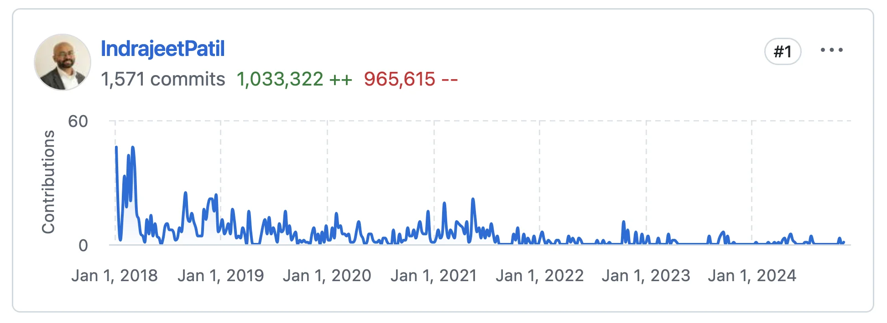{.relative fig-align="center" fig-alt="GitHub contribution chart showing sustained development of ggstatsplot from 2018 through 2024."}

{.relative fig-align="center" fig-alt="GitHub pull request status reporting that all 24 checks have passed."}

:::

:::

::::

::: {.notes}
- Open with Robert C. Martin's adage: "The only way to go fast, is to go well."
- Detail the rigorous CI checks executed on GitHub Actions: randomised unit testing, 100% test coverage, zero linter warnings, automated code formatting, link rot prevention, and multi-platform CRAN validation across Linux, macOS, and Windows.
- Point out the active contribution graph (2018–2024) and the pull request status badge showing 24 passing checks, demonstrating how automated quality gates ensure steady, regression-free development.
:::

## Communication {.smaller .nostretch}

[Training material](https://www.indrapatil.com/presentations/) on best practices in software/package development to support community contributions keeping in mind the diverse backgrounds of contributors.

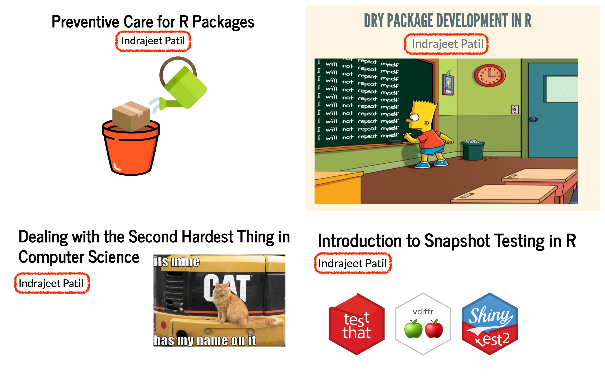{.relative fig-align="center" height="500" fig-alt="Four training decks cover preventive care, DRY development, naming, and snapshot testing for R packages."}

::: {.notes}
- Discuss the educational mission to empower contributors from diverse, non-computer-science backgrounds.
- Showcase the four training slide decks on software engineering best practices: preventive R package care, DRY package development, naming conventions, and snapshot testing.
- Emphasise that accessible documentation and clear contributor guidance transform passive users into active open-source co-maintainers.
:::

## Biography (2017-) {.smaller}

:::{style="font-size: 20px;"}
(Or how developing `{ggstatsplot}` continues to help me grow as a software developer)
:::

```{mermaid}
%%| label: "biography"
%%| echo: false
graph LR
    Project[ggstatsplot]

    %% Technical Skills Branch
    Project --> TechSkills[Technical Skills]
    TechSkills --> CodeQuality[Code Quality]
    TechSkills --> ArchDesign[Architecture Design]
    TechSkills --> TechDebt[Technical Debt]

    %% Soft Skills Branch
    Project --> SoftSkills[Soft Skills]
    SoftSkills --> Collab[Collaboration]
    SoftSkills --> Leadership[Leadership]
    SoftSkills --> Communication[Communication]

    %% Styling using colourblind-friendly palette
    classDef mainNode fill:#FCF596,stroke:#000000,stroke-width:3px
    classDef broardSkillNode fill:#D0E8C5,stroke:#333,stroke-width:1px
    classDef skillNode fill:#ffffff,stroke:#333,stroke-width:1px,stroke-dasharray: 5 5

    class Project mainNode
    class TechSkills,SoftSkills broardSkillNode
    class CodeQuality,ArchDesign,TechDebt,Collab,Leadership,Communication skillNode
```

::: {.notes}
- Walk through the autobiographical concept diagram illustrating dual trajectories of developer growth since 2017.
- Detail the technical branch: mastering code quality standards, modular system architecture, and systematic technical debt reduction.
- Detail the soft skills branch: fostering cross-team collaboration, leading distributed volunteer teams, and communicating technical ideas effectively.
- Conclude that maintaining an open-source project serves as an exceptional long-term crucible for engineering leadership.
:::

# Conclusion

`{ggstatsplot}` offers an <span style="background-color:#D0E8C5;">intuitive interface</span> for creating detailed statistical visualizations, enabling users to adopt <span style="background-color:#FFE31A;">rigorous, reliable, and robust workflows for data exploration and reporting</span> across various academic and industrial disciplines. It is a well-maintained tool with <span style="background-color:#F0C1E1;">high-quality infrastructure</span> and <span style="background-color:#D4F6FF;">widespread adoption</span>.

::: {.notes}
- Summarise the central conclusions of the presentation.
- Highlight the highlighted themes: intuitive user interface, robust and reproducible data analysis workflows, high-calibre software engineering infrastructure, and widespread community adoption.
- Reiterate that combining visual exploration with statistical reporting makes scientific findings both more transparent and more reproducible.
:::

# Thank You 😊

Happy visualizing and reporting!

<br>
<br>

::: {style="text-align: center; font-size: 0.7em;"}

Check out my other [slide decks](https://www.indrapatil.com/presentations/) on software development best practices

:::

::: {style="text-align: center; font-size: 1em;"}

<a class="deck-icon-link" href="https://www.linkedin.com/in/indrajeet-patil-ph-d-397865174/" aria-label="LinkedIn"><span class="deck-icon deck-icon-brands-linkedin" aria-hidden="true"></span></a>
&nbsp;&nbsp;
<a class="deck-icon-link" href="http://github.com/IndrajeetPatil" aria-label="GitHub"><span class="deck-icon deck-icon-brands-github" aria-hidden="true"></span></a>
&nbsp;&nbsp;
<a class="deck-icon-link" href="mailto:patilindrajeet.science@gmail.com" aria-label="Email"><span class="deck-icon deck-icon-solid-envelope" aria-hidden="true"></span></a>

:::

::: {.notes}
- Thank attendees for their time and interest in `{ggstatsplot}`.
- Encourage them to review companion presentations on package development best practices.
- Share contact channels for collaboration, bug reports, and discussion via LinkedIn, GitHub, and email.
:::

## Session information {.smaller}

```{r}
sessioninfo::session_info(include_base = TRUE)
```

::: {.notes}
- Display the computational environment captured via `sessioninfo::session_info(include_base = TRUE)`.
- Explain that archiving complete dependency trees and platform details guarantees long-term computational reproducibility.
:::

# Appendix

::: {.notes}
- Welcome audience to the Appendix.
- Mention that subsequent slides provide deep-dive demonstrations into each plotting function, grouped variants, customisation techniques, and statistical paradigms.
:::

# Examples of other functions

::: {.notes}
- Introduce the function gallery section showcasing specific statistical visualisation tools available in `{ggstatsplot}`.
- Explain that each upcoming slide demonstrates syntax, default visualisations, and supported statistical paradigms for a distinct analytical scenario.
:::

## `ggwithinstats()` {.smaller}

Hypothesis about group differences: repeated measures design

:::: {.columns}

::: {.column width='65%'}
```{r}
#| label: "ggwithinstats_1"
#| fig-alt: "Repeated-measures comparison of wine taste scores across wine types, showing individual observations and statistical summaries."
ggwithinstats(
  data = WRS2::WineTasting,
  x = Wine,
  y = Taste
)
```
:::

::: {.column width='35%'}
:::{.callout-important collapse=false appearance='default' icon=true}
## 

✏️ **Defaults**

-  raw data + distributions 
-  descriptive statistics
-  inferential statistics
-  effect size + uncertainty
-  pairwise comparisons
-  Bayesian hypothesis-testing 
-  Bayesian estimation

**Statistical approaches available**

-  parametric 
-  parametric 
-  robust 
-  Bayesian

:::

:::

::::

::: {.notes}
- Walk through `ggwithinstats()` for repeated-measures designs using `WRS2::WineTasting` (comparing wine `Taste` across `Wine` types).
- Highlight visual features: individual trajectories connected across conditions, box plots, violin densities, and red mean points.
- Review default outputs: parametric repeated-measures ANOVA by default, effect sizes with confidence intervals, pairwise comparisons, and Bayesian test statistics.
:::

## `gghistostats()` {.smaller}

Distribution of a numeric variable

:::: {.columns}

::: {.column width='65%'}

```{r}
#| label: "gghistostats_1"
#| fig-alt: "Histogram of movie budgets, with descriptive and inferential statistics comparing the distribution with a reference value of 30."
gghistostats(
  data = movies_long,
  x = budget,
  test.value = 30 
)
```
:::

::: {.column width='35%'}
:::{.callout-important collapse=false appearance='default' icon=true}
## 

✏️ **Defaults**

-  counts + proportion for bins
-  descriptive statistics
-  inferential statistics
-  effect size + uncertainty
-  pairwise comparisons
-  Bayesian hypothesis-testing 
-  Bayesian estimation

**Statistical approaches available**

-  parametric 
-  parametric 
-  robust 
-  Bayesian

:::

:::

::::

::: {.notes}
- Walk through `gghistostats()` evaluating the distribution of movie `budget` from `movies_long` against a test reference value of 30 (`test.value = 30`).
- Point out automatic features: frequency bins with proportion labels, overlaid density curve, test value marker, and one-sample test statistics with Bayes factor.
- Note availability of parametric, non-parametric, robust, and Bayesian one-sample tests.
:::

## `ggdotplotstats()` {.smaller}

Labeled numeric variable

:::: {.columns}

::: {.column width='65%'}

```{r}
#| label: "ggdotplotstats_1"
#| fig-alt: "Movie budgets by genre, displayed as a labeled dot plot with statistical summaries and a reference value of 30."
ggdotplotstats(
  data = movies_long,
  x = budget,
  y = genre,
  test.value = 30 
)
```
:::

::: {.column width='35%'}
:::{.callout-important collapse=false appearance='default' icon=true}
## 

✏️ **Defaults**

-  descriptive statistics
-  inferential statistics
-  effect size + uncertainty
-  pairwise comparisons
-  Bayesian hypothesis-testing 
-  Bayesian estimation

**Statistical approaches available**

-  parametric 
-  parametric 
-  robust 
-  Bayesian

:::

:::

::::

::: {.notes}
- Walk through `ggdotplotstats()` displaying movie `budget` by `genre` from `movies_long`, compared against a reference threshold of 30.
- Explain why dot plots are preferred over bar charts for labelled numeric data: lower visual clutter and higher data clarity.
- Point out summary metrics, uncertainty intervals, and one-sample test details displayed in the subtitle.
:::

## `ggscatterstats()` {.smaller}

Hypothesis about correlation: Two numeric variables

:::: {.columns}

::: {.column width='65%'}

```{r}
#| label: "ggscatterstats_1"
#| fig-alt: "Scatterplot of movie budget against rating, with marginal distributions, a fitted relationship, and correlation statistics."
ggscatterstats(
  data = movies_long,
  x = budget,
  y = rating
)
```
:::

::: {.column width='35%'}
:::{.callout-important collapse=false appearance='default' icon=true}
## 

✏️ **Defaults**

-  joint distribution
-  marginal distribution
-  effect size + uncertainty
-  pairwise comparisons
-  Bayesian hypothesis-testing 
-  Bayesian estimation

**Statistical approaches available**

-  parametric 
-  parametric 
-  robust 
-  Bayesian

:::

:::

::::

::: {.notes}
- Walk through `ggscatterstats()` assessing bivariate correlation between movie `budget` and `rating` in `movies_long`.
- Highlight composite structure: central scatterplot with linear regression fit and confidence band, accompanied by top and right marginal density histograms.
- Note the subtitle detailing Pearson correlation ($r$), sample size ($n$), confidence intervals, and Bayesian evidence in favour of or against the relationship.
:::

## `ggcorrmat()` {.smaller}

Hypothesis about correlation: Multiple numeric variables

:::: {.columns}

::: {.column width='65%'}

```{r}
#| label: "ggcorrmat_1"
#| fig-alt: "Correlation matrix for numeric variables in the Star Wars dataset, using colour and labels to show the direction and strength of relationships."
ggcorrmat(dplyr::starwars)
```
:::

::: {.column width='35%'}
:::{.callout-important collapse=false appearance='default' icon=true}
## 

✏️ **Defaults**

-  inferential statistics
-  effect size + uncertainty
-  careful handling of `NA`s
-  partial correlations

**Statistical approaches available**

-  parametric 
-  parametric 
-  robust 
-  Bayesian

:::

:::

::::

::: {.notes}
- Walk through `ggcorrmat(dplyr::starwars)` calculating and visualizing pairwise correlations across all numeric variables in a dataset.
- Point out the correlation matrix layout: colour gradient indicating correlation sign and magnitude, significance filtering, and robust handling of missing values (`NA`).
- Mention that partial correlations and multiple comparison adjustments are supported out of the box.
:::


## `ggpiestats()` {.smaller}

Hypothesis about composition of categorical variables

:::: {.columns}

::: {.column width='65%'}

```{r}
#| label: "ggpiestats_1"
#| fig-alt: "Pie charts comparing transmission categories across cylinder groups in the mtcars dataset, with proportions and association statistics."
ggpiestats(
  data = mtcars,
  x = am,
  y = cyl
)
```
:::

::: {.column width='35%'}
:::{.callout-important collapse=false appearance='default' icon=true}
## 

✏️ **Defaults**

-  descriptive statistics
-  inferential statistics
-  effect size + uncertainty
-  goodness-of-fit tests
-  Bayesian hypothesis-testing 
-  Bayesian estimation

:::

:::

::::

::: {.notes}
- Walk through `ggpiestats()` examining categorical associations between transmission type (`am`) and cylinder count (`cyl`) in `mtcars`.
- Point out slice percentages, category counts, and Pearson's chi-squared test of independence in the subtitle.
- Mention embedded goodness-of-fit tests for individual slices and Bayesian contingency table statistics.
:::

## `ggbarstats()` {.smaller}

Hypothesis about composition of categorical variables

:::: {.columns}

::: {.column width='65%'}

```{r}
#| label: "ggbarstats_1"
#| fig-alt: "Stacked bar chart comparing transmission categories across cylinder groups in mtcars, with counts, proportions, and association statistics."
ggbarstats(
  data = mtcars,
  x = am,
  y = cyl
)
```
:::

::: {.column width='35%'}
:::{.callout-important collapse=false appearance='default' icon=true}
## 

✏️ **Defaults**

-  descriptive statistics
-  inferential statistics
-  effect size + uncertainty
-  goodness-of-fit tests
-  Bayesian hypothesis-testing 
-  Bayesian estimation

:::

:::

::::

::: {.notes}
- Walk through `ggbarstats()` displaying the same categorical association between `am` and `cyl` as a 100% stacked bar chart.
- Contrast with pie charts: stacked bars often allow more accurate perceptual comparison of category proportions while conveying identical statistical tests.
- Reiterate that both `ggpiestats()` and `ggbarstats()` share identical arguments and statistical backends.
:::

## `ggcoefstats()` {.smaller}

Hypothesis about regression coefficients

:::: {.columns}

::: {.column width='65%'}

```{r}
#| label: "ggcoefstats_1"
#| fig-alt: "Regression coefficient estimates and uncertainty intervals for a model of movie ratings by MPAA category."
mod <- lm(
  formula = rating ~ mpaa,
  data = movies_long
)

ggcoefstats(mod)
```
:::

::: {.column width='35%'}
:::{.callout-important collapse=false appearance='default' icon=true}
## 

✏️ **Defaults**

-  estimate + uncertainty
-  inferential statistics ($t$, $z$, $F$, $\chi^2$)
-  model fit indices (AIC + BIC)

Supports all regression models supported in [`{easystats}`](https://easystats.github.io/insight/reference/is_model_supported.html) ecosystem.

Meta-analysis is also supported!

:::

:::

::::

::: {.notes}
- Walk through `ggcoefstats(mod)` displaying model parameters from a linear model (`lm(rating ~ mpaa, data = movies_long)`).
- Highlight visual features: point estimates with confidence intervals, intercept and factor level comparisons, and test statistics ($t$, $z$, $F$, $\chi^2$) alongside AIC and BIC indices.
- Emphasise that via `{insight}`, `ggcoefstats()` supports hundreds of model classes across the R ecosystem, as well as meta-analytic models.
:::


# *grouped\_* variants

Iterating over a grouping variable

::: {.notes}
- Introduce `grouped_` variants: convenience wrapper functions that apply statistical visualizations across levels of a grouping factor.
- Explain that these eliminate the need to write manual `purrr::map()` loops or complex facet pipelines for exploratory analysis.
:::

## *grouped\_* functions {.smaller}

:::: {.columns}

::: {.column width='60%'}
```{r grouped_1}
#| fig-alt: "Pie charts of cylinder counts in mtcars, separately for automatic and manual transmission groups, with proportions and statistical summaries."
grouped_ggpiestats(
  data = mtcars,
  x = cyl,
  grouping.var = am 
)
```
:::

::: {.column width='40%'}

:::{.callout-tip collapse=false appearance='default' icon=true}

## Available `grouped_` variants:

- `grouped_ggbetweenstats()` 
- `grouped_ggwithinstats()` 
- `grouped_gghistostats()` 
- `grouped_ggdotplotstats()` 
- `grouped_ggscatterstats()` 
- `grouped_ggcorrmat()` 
- `grouped_ggpiestats()` 
- `grouped_ggbarstats()`

:::

:::

::::

::: {.notes}
- Walk through `grouped_ggpiestats(data = mtcars, x = cyl, grouping.var = am)`.
- Explain how the function automatically splits the dataset by `am` (transmission type), generates independent pie charts for each subset, and combines them into a single coherent figure.
- Review the callout listing available `grouped_` variants for every primary function in the package.
:::

# Customizability

"What if I don't like the default plots?" 🤔

::: {.notes}
- Introduce the Customizability section addressing user desires to tailor plot aesthetics, colour palettes, and statistical output.
- Emphasise that `{ggstatsplot}` defaults are opinions, not mandates; every visual and statistical element remains fully configurable.
:::

## Modify the look 🎨 {.smaller}

. . . 

:::: {.columns}

::: {.column width='50%'}

By changing **theme** and **palette**

```{.r code-line-numbers="5-6"}
ggbetweenstats(
  data = movies_long,
  x = mpaa,
  y = rating,
  ggtheme = ggthemes::theme_economist(),
  palette = "wesanderson::Darjeeling2"
)
```

:::

::: {.column width='50%'}

```{r}
#| label: "ggbetweenstats_4"
#| fig-alt: "Movie rating distributions by MPAA category, demonstrating a custom Economist theme and Darjeeling colour palette."
#| echo: false
ggbetweenstats(
  data = movies_long,
  x = mpaa,
  y = rating,
  ggtheme = ggthemes::theme_economist(),
  palette = "wesanderson::Darjeeling2"
)
```

:::

::::

. . . 

:::: {.columns}

::: {.column width='50%'}

By using `{ggplot2}` functions

```{.r code-line-numbers="7"}
ggbetweenstats(
  data = mtcars,
  x = am,
  y = wt,
  type = "bayes"
) +
  scale_y_continuous(sec.axis = dup_axis()) 
```

:::

::: {.column width='50%'}

```{r}
#| label: "ggbetweenstats_5"
#| fig-alt: "Car weight distributions by transmission type, demonstrating Bayesian statistics and a duplicated vertical axis."
#| echo: false
ggbetweenstats(
  data = mtcars,
  x = am,
  y = wt,
  type = "bayes"
) +
  scale_y_continuous(sec.axis = dup_axis())
```

:::

::::

::: {.notes}
- Walk through aesthetic customisation using theme and palette arguments:
  - First example: passing `ggtheme = ggthemes::theme_economist()` and `palette = "wesanderson::Darjeeling2"` to `ggbetweenstats()`.
  - Second example: composing with native `{ggplot2}` functions, such as appending `scale_y_continuous(sec.axis = dup_axis())` to add a secondary axis to Bayesian output.
- Stress that returned objects are native `{ggplot2}` plots that support any standard ggplot geoms, scales, or theme modifications.
:::


## Too much information 🙈 {.smaller}

. . . 

:::: {.columns}

::: {.column width='40%'}

Get **only plots**:

```{.r code-line-numbers="5-10"}
ggbetweenstats(
  data = iris,
  x = Species,
  y = Sepal.Length,
  # turn off statistical analysis
  centrality.plotting = FALSE, 
  results.subtitle = FALSE, 
  bf.message = FALSE, 
  # turn off pairwise comparisons
  pairwise.display = "none" 
)
```

:::

::: {.column width='60%'}

```{r}
#| label: "ggbetweenstats_only_plot"
#| fig-alt: "Iris sepal length distributions by species with raw points and violin and box plots; statistical annotations and pairwise comparisons are turned off."
#| echo: false
ggbetweenstats(
  data = iris,
  x = Species,
  y = Sepal.Length,
  # turn off statistical analysis
  centrality.plotting = FALSE, 
  results.subtitle = FALSE, 
  bf.message = FALSE, 
  # turn off pairwise comparisons
  pairwise.display = "none" 
)
```

:::

::::

. . . 

:::: {.columns}

::: {.column width='40%'}

Get **only expressions**:

```{.r code-line-numbers="4,6,10"}
stats_expr <- ggpiestats(
  Titanic_full, Survived, Sex,
) %>% 
  extract_subtitle()

suppressWarnings(print(ggiraphExtra::ggSpine(
  data = Titanic_full,
  aes(x = Sex, fill = Survived)
) +
  labs(subtitle = stats_expr)))
```

:::

::: {.column width='60%'}

```{r}
#| label: "ggpiestats_only_plot"
#| fig-alt: "Mosaic-style plot of Titanic survival by sex, with a statistical expression extracted from ggpiestats used as the subtitle."
#| echo: false
stats_expr <- ggpiestats(
  Titanic_full, Survived, Sex,
) %>% 
  extract_subtitle()

suppressWarnings(print(ggiraphExtra::ggSpine(
  data = Titanic_full,
  aes(x = Sex, fill = Survived)
) +
  labs(subtitle = stats_expr)))
```

:::

::::

::: {.notes}
- Explain how to tune the density of information when full statistical annotations are not desired.
- Top example: turning off statistical displays using `centrality.plotting = FALSE`, `results.subtitle = FALSE`, `bf.message = FALSE`, and `pairwise.display = "none"` to obtain a clean, publication-ready base plot.
- Bottom example: extracting statistical expressions using `extract_subtitle()` on `ggpiestats(Titanic_full, Survived, Sex)` and reusing that formatted subtitle in alternative visualisations, such as `ggiraphExtra::ggSpine()`.
:::

# `{ggstatsplot}`: Details about statistical reporting 

::: {.notes}
- Transition to the detailed statistical reporting section.
- Frame the methodological core: providing comprehensive, unified support for multiple statistical paradigms across all package functions.
:::

## Supports different statistical approaches {.smaller}

:::{.callout-note collapse=false appearance='default' icon=true}
## 

| Functions                            | Description                                       | Parametric | Non-parametric | Robust | Bayesian |
| :----------------------------------- | :------------------------------------------------ | :--------- | :------------- | :----- | :------- |
| `ggbetweenstats()`                   | Between group comparisons                         | ✅         | ✅             | ✅     | ✅       |
| `ggwithinstats()`                    | Within group comparisons                          | ✅         | ✅             | ✅     | ✅       |
| `gghistostats()`, `ggdotplotstats()` | Distribution of a numeric variable                | ✅         | ✅             | ✅     | ✅       |
| `ggcorrmat()`                        | Correlation matrix                                | ✅         | ✅             | ✅     | ✅       |
| `ggscatterstats()`                   | Correlation between two variables                 | ✅         | ✅             | ✅     | ✅       |
| `ggpiestats()`, `ggbarstats()`       | Association between categorical variables         | ✅         | `NA`           | `NA`   | ✅       |
| `ggpiestats()`, `ggbarstats()`       | Equal proportions for categorical variable levels | ✅         | `NA`           | `NA`   | ✅       |
| `ggcoefstats()`                      | Regression modeling                               | ✅         | ✅             | ✅     | ✅       |
| `ggcoefstats()`                      | Random-effects meta-analysis                      | ✅         | `NA`           | ✅     | ✅       |

:::

::: {.notes}
- Walk through the function-by-approach compatibility table.
- Highlight that across between-group comparisons, within-group tests, distributions, correlations, and regressions, users can switch between parametric, non-parametric, robust, and Bayesian frameworks.
- Point out where specific combinations are non-applicable (e.g. non-parametric or robust tests for categorical contingency tables).
:::

## Toggling statistical approaches 🔀 {.smaller}

:::: {.columns}

::: {.column width='50%'}

**Parametric**

```{.r code-line-numbers="6,14,22"}
# anova
ggbetweenstats(
  data = mtcars,
  x = cyl,
  y = wt,
  type = "p" 
)

# correlation analysis
ggscatterstats(
  data = mtcars,
  x = wt,
  y = mpg,
  type = "p" 
)

# t-test
gghistostats(
  data = mtcars,
  x = wt,
  test.value = 2,
  type = "p" 
)
```
:::

::: {.column width='50%'}

**Non-parametric**

```{.r code-line-numbers="6,14,22"}
# anova
ggbetweenstats(
  data = mtcars,
  x = cyl,
  y = wt,
  type = "np" 
)

# correlation analysis
ggscatterstats(
  data = mtcars,
  x = wt,
  y = mpg,
  type = "np" 
)

# t-test
gghistostats(
  data = mtcars,
  x = wt,
  test.value = 2,
  type = "np" 
)
```

:::

::::

::: {.notes}
- Demonstrate how seamless it is to toggle statistical paradigms in code.
- Contrast the parametric column (`type = "p"`) on the left with the non-parametric column (`type = "np"`) on the right across ANOVA (`ggbetweenstats`), correlation (`ggscatterstats`), and one-sample tests (`gghistostats`).
- Emphasise the cognitive savings: researchers only need to change the `type` argument, without learning entirely different packages or altering their data format.
:::


## Alternative: Pure Pain {.smaller}

:::: {.columns}

::: {.column width='50%'}

:::{.callout-caution collapse=false appearance='default' icon=true}

## Hunting for packages

📦 for inferential statistics (`{stats}`) <br>
📦 computing effect size + CIs (`{effectsize}`) <br> 
📦 for descriptive statistics (`{skimr}`) <br> 
📦 pairwise comparisons (`{multcomp}`) <br>
📦 Bayesian hypothesis testing (`{BayesFactor}`) <br> 
📦 Bayesian estimation (`{bayestestR}`) <br> 
📦 ... <br> 

{.relative fig-align="center" width="350" height="250" fig-alt="A worker struggles with many packages on a loading platform, illustrating the burden of coordinating many statistical packages."}

:::

:::

::: {.column width='50%'}

:::{.callout-caution collapse=false appearance='default' icon=true}

## Inconsistent APIs

🤔 accepts data frame, vector, matrix? <br>
🤔 long/wide format data? <br> 
🤔 works with `NA`s? <br>
🤔 returns data frame, vector, matrix? <br>
🤔 works with tibbles? <br> 
🤔 has all necessary details? <br> 
🤔 ... <br>

{.relative fig-align="center" width="350" height="250" fig-alt="A monkey uses a laptop, humorously illustrating the frustration of doing repetitive analysis manually."}

:::

:::

::::

::: {.notes}
- Contrast the unified `{ggstatsplot}` API with the status quo across two pain points.
- Left column (hunting for packages): assembling an analysis requires stitching together `{stats}`, `{effectsize}`, `{skimr}`, `{multcomp}`, `{BayesFactor}`, and `{bayestestR}`.
- Right column (inconsistent APIs): juggling conflicting input requirements (vectors vs matrices vs tibbles), differing return types, and incompatible missing-value policies.
- Humourous illustrations highlight the friction and cognitive load `{ggstatsplot}` removes.
:::

## Benefits in details {.smaller}

`{ggstatsplot}` combines data visualization and statistical analysis in a single step.

It...

:::{style="background-color: #FFDCA9; padding: 20px; border-radius: 25px;"}

::: {.fragment .highlight-current-blue}
- provides ready-made plots with information-rich defaults
:::

::: {.fragment .highlight-current-blue}
- minimizes the chances of making errors in statistical reporting
:::

::: {.fragment .highlight-current-blue}
- follows best practices in data visualization and statistical reporting
:::

::: {.fragment .highlight-current-blue}
- helps evaluate statistical analysis in the context of the underlying data 
:::

::: {.fragment .highlight-current-blue}
- highlights the importance of the effect by providing effect size measures
:::

::: {.fragment .highlight-current-blue}
- provides an easy way to evaluate *absence* of an effect using Bayesian framework 
:::

::: {.fragment .highlight-current-blue}
- extremely beginner-friendly
:::

:::

::: {.notes}
- Review the comprehensive benefits summary:
  - Ready-made plots with information-rich defaults.
  - Substantial reduction in statistical reporting and transcription errors.
  - Strict compliance with data visualisation and reporting standards.
  - Contextual evaluation of statistical models against raw data distributions.
  - Prominent emphasis on effect sizes and uncertainty.
  - Seamless evaluation of null results via Bayes factors.
  - Beginner-friendly syntax for novice and expert analysts alike.
:::

## Simplified data analysis workflow {.smaller .nostretch}

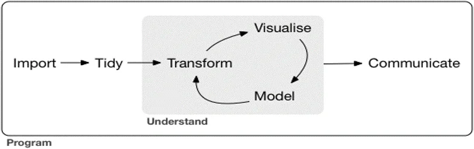{height="330" style="max-width: 100%;" fig-alt="Data analysis proceeds from import and tidying into an iterative cycle of transformation, visualization, and modeling, followed by communication."}

::: footer
[(Grolemund & Wickham, *R for Data Science*, 2017)](https://r4ds.had.co.nz/)
:::

<br>

:::{style="background-color: #FDE7BB; padding: 20px; border-radius: 25px; text-align: center;"}

✅ Quick insight into data by combining visualization and modeling!

:::

::: {.notes}
- Revisit the classic data science workflow diagram from Grolemund & Wickham (2017): import, tidy, transform-visualise-model, and communicate.
- Explain how `{ggstatsplot}` collapses the iterative transform-visualise-model loop into a single step, giving instant visual and statistical feedback.
- Emphasise that faster iteration accelerates hypothesis generation and scientific discovery.
:::

## Community Involvement {.smaller}

- 11 contributors

- 7 reverse dependencies

- Widely covered in [YouTube videos](https://www.youtube.com/results?search_query=ggstatsplot) and [social media posts](https://x.com/search?q=ggstatsplot&src=typed_query)

- Most tagged questions answered on [StackOverflow](https://stackoverflow.com/questions/tagged/ggstatsplot)

- Hundreds of unique visitors every fortnight on [GitHub repo](https://github.com/IndrajeetPatil/ggstatsplot/)

- Usage in a wide [range of fields](https://scholar.google.com/scholar?hl=en&scisbd=1&as_sdt=0%2C22&q=ggstatsplot&btnG=): psychology, biology, medicine, economics, etc.

- Usage in data science training programs

::: {.notes}
- Review indicators of community adoption and engagement.
- Highlight open-source collaboration metrics: 11 direct code contributors and 7 reverse CRAN dependencies.
- Mention active external adoption: community YouTube tutorials, extensive StackOverflow Q&A, and broad usage across psychology, medicine, biology, and economics.
:::

## A grain of salt {.smaller}

### The "Golem of Prague" problem

:::: {.columns}

::: {.column width='40%'}

<br><br>

:::{style="background-color: #FDE7BB; padding: 20px; border-radius: 25px; text-align: center;"}
❌  Promotes mindless application of statistical tests.
:::

:::

::: {.column width='60%'}
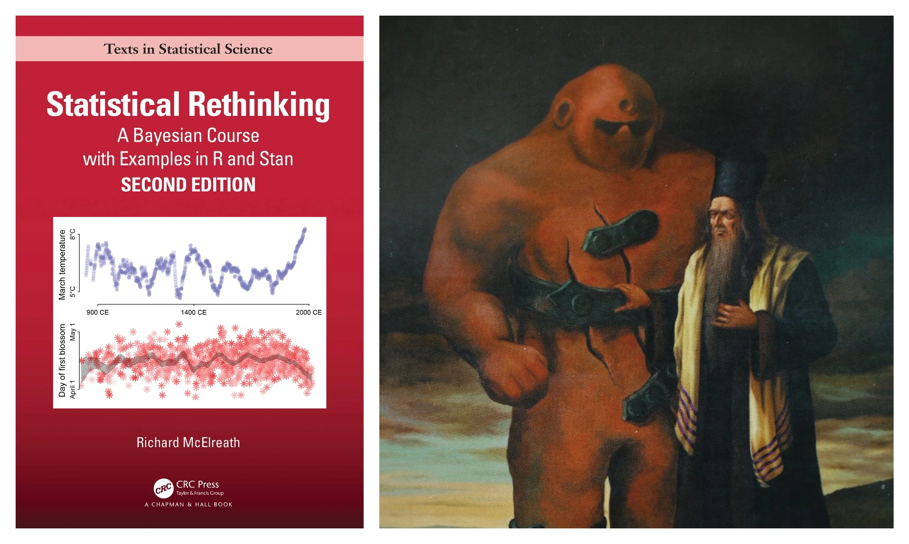{.relative fig-align="center" fig-alt="Richard McElreath’s Statistical Rethinking book beside an illustration of the Golem of Prague, warning that tools execute instructions without understanding intent."}
:::

::::

::: {.notes}
- Conclude with an essential methodological caveat: Richard McElreath's "Golem of Prague" metaphor from *Statistical Rethinking*.
- Explain that statistical software is like a mythical golem: powerful and obedient, but utterly lacking scientific context or intent.
- Caution attendees against mindless application of statistical tests: no software substitute exists for thoughtful experimental design, critical evaluation of assumptions, and domain understanding.
:::
